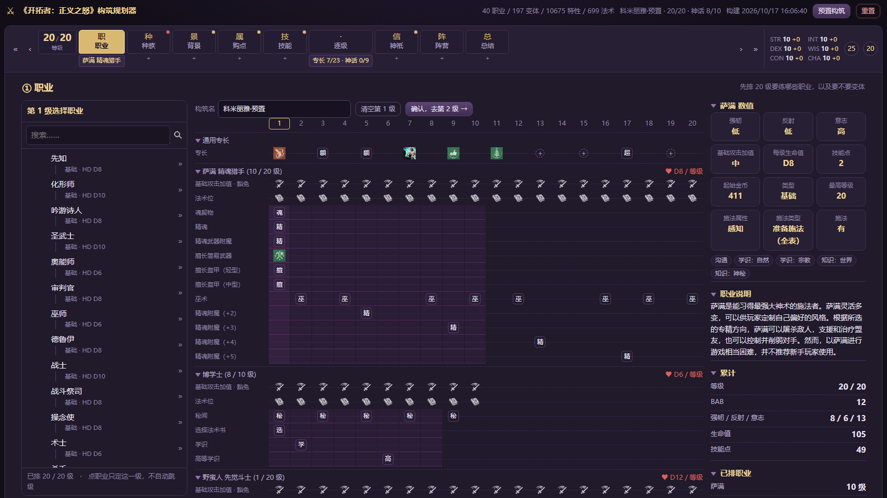
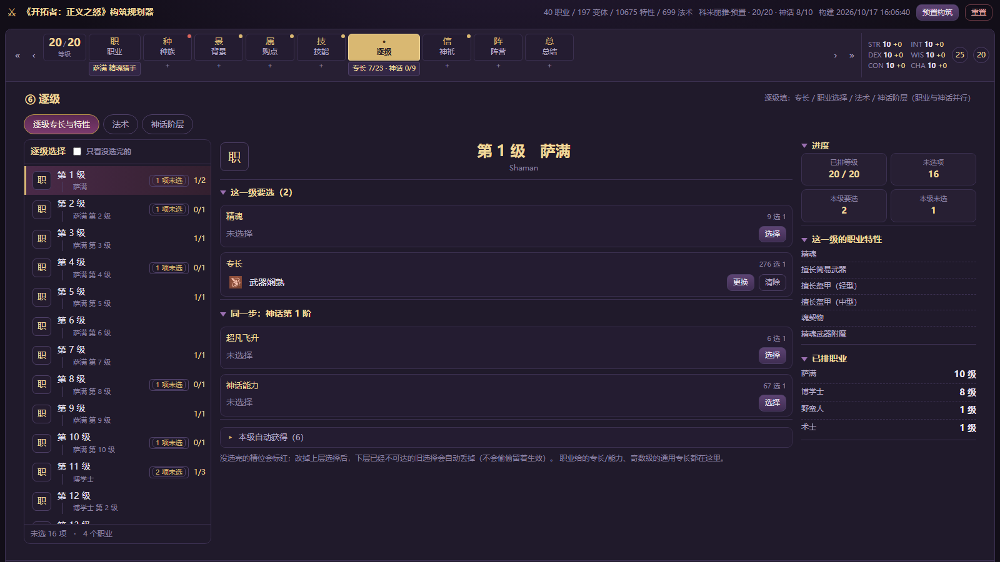
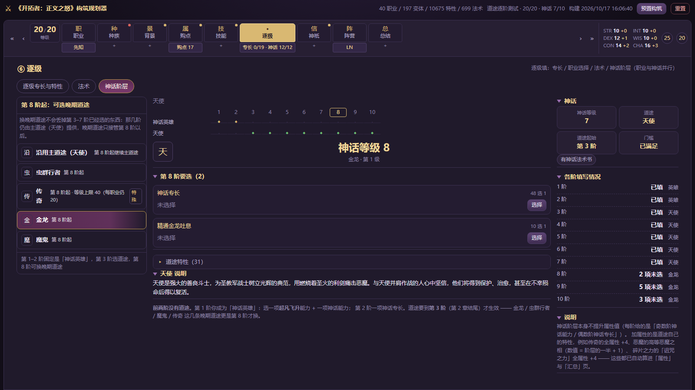
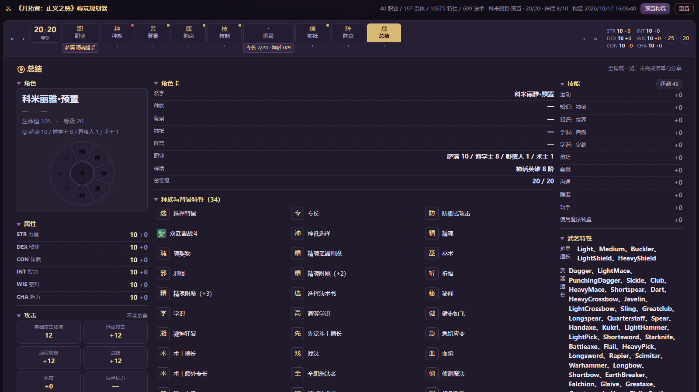

# 开拓者：正义之怒 · 中文构筑规划器（网页版）

[**在线试用**](https://dovek0908.github.io/wotr-build-builder/) ｜ [数据格式](docs/data-format.md) ｜ [界面复刻说明](docs/game-ui-spec.md) ｜ [预置构筑来源](docs/presets-source.md)

[rt-planner](https://rt-planner.pages.dev/) 式的《Pathfinder: Wrath of the Righteous》**中文**构筑规划器：按游戏自己的角色创建流程，一步步把 1–20 级职业与 10 阶神话道途排完，顺手把前置条件、阵营限制、法术位都算清楚。

**和网上流传的构筑资料最大的不同：数据不是手抄的。** 全部内容直接从本机安装的游戏本体解包：

| 来源 | 内容 |
| --- | --- |
| `blueprints.zip` | 25 万个游戏蓝图：职业、变体、专长、法术、神话道途、种族、背景……含逐级升级表与前置条件 |
| `StreamingAssets/Localization/zhCN.json` | 11 万条**官方简体中文**名称与描述 |
| `BlueprintRoot.Progression` | 「角色创建时能选哪些职业 / 种族 / 神话道途」的权威名单（不是手写清单） |

所以界面上每一个专长名、每一段描述、每一条「前置要求」，都是游戏原版数据。



---

## 功能一览

| 步骤（照游戏排） | 做了什么 |
| --- | --- |
| ① 职业 | 27 基础 + 13 进阶；点职业只定这一级、**不自动跳级**；变体在左栏该职业下面展开（原作规则：一个职业同时只能有一个变体）；成长表按「这个职业排到了第几级」高亮，并可逐级查看 **BAB / 三豁免 / 各环法术位** |
| ② 种族 | 12 个可选种族 + 传承链（`种族传承 › 基本 › 一技之长 › 技能专攻`）；人类 / 半精灵 / 半兽人的「任选一项 +2」 |
| ③ 背景 | 游戏的三层结构：大类 → 具体背景 → 有些还要再选一项（例：自然学者要选一个德鲁伊戏法） |
| ④ 购点 | 标准 25 点表，属性按「基础 / 种族 / 升级 / 特性 / 手工」拆开显示 |
| ⑤ 技能 | 本职技能、逐级技能点、关键属性调整 |
| ⑥ 逐级 | **职业与神话并行的主战场**：左边逐级卡片，右边这一级的槽位、进度与职业特性；同一个卡片里还有「同一步：神话第 N 阶」 |
| ⑦ 神祇 | 33 个信仰，各自的阵营限制；中间是照游戏做的「先决条件（N/M）」逐条打勾 |
| ⑧ 阵营 | 八瓣扇形轮盘；锁住的阵营写明原因（先改职业 / 变体 / 神祇通常就能解开） |
| ⑨ 总结 | 按游戏角色卡排：左栏角色牌 + 属性 + 攻击框 + 防御与豁免框，中栏成长表与特性图标网格，右栏技能 / 武艺特性 / 分享与存档 |

**贯穿全局的几件事**

- **前置条件实时判定**：候选会标 `可用 / 前置不足 / 无法判定`，并用中文写出原因（属性、职业等级、前置专长、选择列表、神话阶层、施法类型……）。游戏里 30 种前置组件全部导出；`oneof` 按「需要 N 项」判；88 个选择表在游戏里本来就是「不检查前置」，界面照实标出来。
- **条件树也能算**：29 条前置是 `OrAndLogic` 条件树（含「该特性拿了几遍 ≥ 3」这种可重复专长的上限，例如额外奥秘 / 额外奥能技艺 / 额外狂暴特技），已拆成 `fact / factrank / class / mrank / align` 逐叶求值。
- **选择里的选择**：很多选项本身还是选择表（`战斗专长 › 战斗流派专长`、`额外专长 › 高等元素专攻`、`神话能力 › 巅峰元素`），界面一层层展开；改写上层后不可达的旧选择会被丢掉，不会悄悄留在构筑里。
- **阵营不是摆设**：职业 / 变体 / 神祇 / 领域都带门槛；变体自带阵营要求时**取代**母职业的（游戏里唯一一例：武僧 × 醉拳大师）。
- **神话**：第 1–2 阶固定是「神话英雄」，第 3 阶（第 2 章结尾）才选道途；第 8 阶起可换金龙 / 虫群行者 / 魔鬼 / 传奇，**换道途不会丢前面选过的东西**。传奇单独处理（全属性 +4、等级上限 40、每个职业仍最多 20 级）。
- **阶层与等级怎么对应**：游戏里神话阶层是**按剧情节点**给的，不按经验值；规划器照社区整理的解锁表估算「到第 N 级时最多能有几个阶层」—— 第 1–10 阶约在 **6 / 8 / 10 / 13 / 15 / 17 / 18 / 18 / 19 / 20 级**（这张表也用在「逐级」的前置推算与阶层卡片的「约 N 级」上）。
- **道途法术书**：天使 / 巫妖并进职业法术书，御衡者 / 灵使 / 恶魔 / 诡计大师 / 金龙是独立法术书；要自己挑法术的道途会为每一环出一块「法术:等级 N」牌匾。
- **分享与存档**：分享链接（`#b=…`）、构筑代码、JSON 导出 / 导入；另有 **24 套**内置中文队友 BD 可一键载入。

## 界面

牌匾步骤条、三栏版面、牌匾上的「已选值」、动态长出的职业 / 道途子牌匾 —— 都是照游戏的角色创建界面复刻的（细节与取舍见 [docs/game-ui-spec.md](docs/game-ui-spec.md)）。

| 逐级（职业与神话并行） | 神话道途 |
| --- | --- |
|  |  |



## 数据从哪来

默认读取本机 Steam 安装目录（可用环境变量 `WOTR_GAME_DIR` 或 `--game <目录>` 覆盖）：

```
D:\SteamLibrary\steamapps\common\Pathfinder Second Adventure
```

管线**只读** `blueprints.zip` 与 `Localization/*.json`，不改游戏本体。产出与解析细节见 [docs/data-format.md](docs/data-format.md)（含本地化键怎么解析、哪些常量必须内置、条件树怎么拆、前置组件普查）。

## 快速开始

### 只想起个本地站点

双击仓库根目录的 `启动网页版.bat`：需要时装依赖 → 生产构建 → 用内置零依赖静态服务器发布到 http://127.0.0.1:5200/ （加 `--no-open` 可以只起服务不开浏览器）。

手动来：

```powershell
cd web
node node_modules\vite\bin\vite.js build          # 产出 dist（约 19 MB，含数据与素材）
node scripts\serve.mjs --port 5200                # 只监听本机
node scripts\serve.mjs --host 0.0.0.0 --port 5200 # 同一局域网的手机 / 平板也能看
```

### 重新生成数据

```powershell
# 1) 提取官方数据（约 7 秒 → web\public\data\*.json 约 9.7 MB）
python pipeline\build_data.py --out web\public\data

# 2) 数据自检（有硬错误以退出码 1 结束）
python pipeline\check_data.py

# 3) 提取游戏素材（约 14 秒 → web\public\assets，约 9 MB；需要 UnityPy）
python -m pip install UnityPy
python pipeline\extract_ui.py

# 4) 可选：重新生成预置构筑（需要 BD 合集，见 docs\presets-source.md）
python pipeline\import_presets.py
```

```powershell
cd web
npm.cmd install      # PowerShell 下必须带 .cmd，npm.ps1 被执行策略拦住
npm.cmd run dev      # 开发服务器
npm.cmd run build    # 生产构建

node scripts\smoke.mjs                     # 规则引擎冒烟测试（279 项）
powershell -File scripts\render-check.ps1  # 无头 Chrome 逐个渲染 9 个步骤
```

> 改 `web/src/**` 之前先停掉 vite（否则写文件报 `ReplaceFileW EIO (Win32 1175)`）：
> `(Get-NetTCPConnection -LocalPort 5199 -State Listen).OwningProcess | Stop-Process -Force`

### 传到公网

游戏素材（立绘卡 + 991 个内容图标）是 Owlcat 的版权物、也不入库，所以公网版用「不含素材」的构建：

```powershell
cd web
npm.cmd run build:public   # = tsc + vite build --mode public + scripts\strip-art.mjs
```

`VITE_ART=0` 会让界面不引用任何素材（立绘卡变文字行、图标回退成首字徽记），产物约 **9.6 MB**，全是页面与规则数据，丢进子目录也能跑。

| 平台 | 设置 |
| --- | --- |
| **GitHub Pages** | 已带 `.github/workflows/pages.yml`：推送后在 Settings → Pages → Source 选 **GitHub Actions** 即可 |
| **Cloudflare Pages** | Root directory `web`，Build command `npm run build:public`，Output directory `dist` |
| **Vercel** | Root Directory `web`，Build Command `npm run build:public`，Output Directory `dist` |

CI 上跑不了数据管线（要读本机游戏安装），所以 `web/public/data/*.json` 是随仓库提交的。

## 项目结构

```
.
├── archive/                 旧 Tkinter 构筑工具（独立归档，自带 git 仓库）
├── pipeline/                Python 数据管线
│   ├── build_data.py        游戏数据 → web/public/data/*.json（带硬校验）
│   ├── check_data.py        管线产物自检
│   ├── extract_ui.py        游戏素材 → web/public/assets/（需要 UnityPy）
│   └── import_presets.py    中文 BD 合集 → presets.json
├── web/                     前端（Vite + React + TypeScript）
│   ├── public/data/         管线产物（13 个 JSON，约 9.7 MB）
│   ├── public/assets/       74 张界面贴图 + 995 个内容图标（不入库）
│   ├── src/                 数据层（load / store / rules / steps）+ 9 个步骤界面
│   └── scripts/             冒烟测试、无头渲染检查、静态服务器
└── docs/                    数据格式、界面复刻说明、预置来源、截图
```

## 刻意与游戏不同的地方

- **神祇 / 阵营随时可改**：游戏里一旦确定就不能改，这里留着是为了方便对比不同信仰与阵营的构筑（改完职业与领域会按新阵营重判）。
- **三类前置口径调整不拦人**：`ReplaceStatForPrerequisites`（换个属性算）、`PrerequisiteSelectionPossible`（只影响提示）、`ClassLevelsForPrerequisites`（按另一个职业的等级算）。它们改的是「怎么算」而不是门槛本身，目前判为「无法判定」，既不算通过也不判失败。
- **不含立绘 / 3D 模型**：按需求只保留数值与图标。

## 许可与致谢

- 本项目代码以 **GPL-3.0** 发布（与最初的 Tkinter 工具一致）。
- 游戏数据（蓝图与本地化文本）版权归 **Owlcat Games**；本项目只在本机提取供个人构筑规划使用，不再分发游戏资源本体。
- 界面素材（`web/public/assets/**`）同样是从本机正版安装提取的 Owlcat 版权素材，**已被 `.gitignore` 排除**；公开部署请用 `npm run build:public`，或自行替换素材。
- 预置构筑的文字内容来自社区中文 BD 合集，版权归原作者，来源与解析方式见 [docs/presets-source.md](docs/presets-source.md)。
